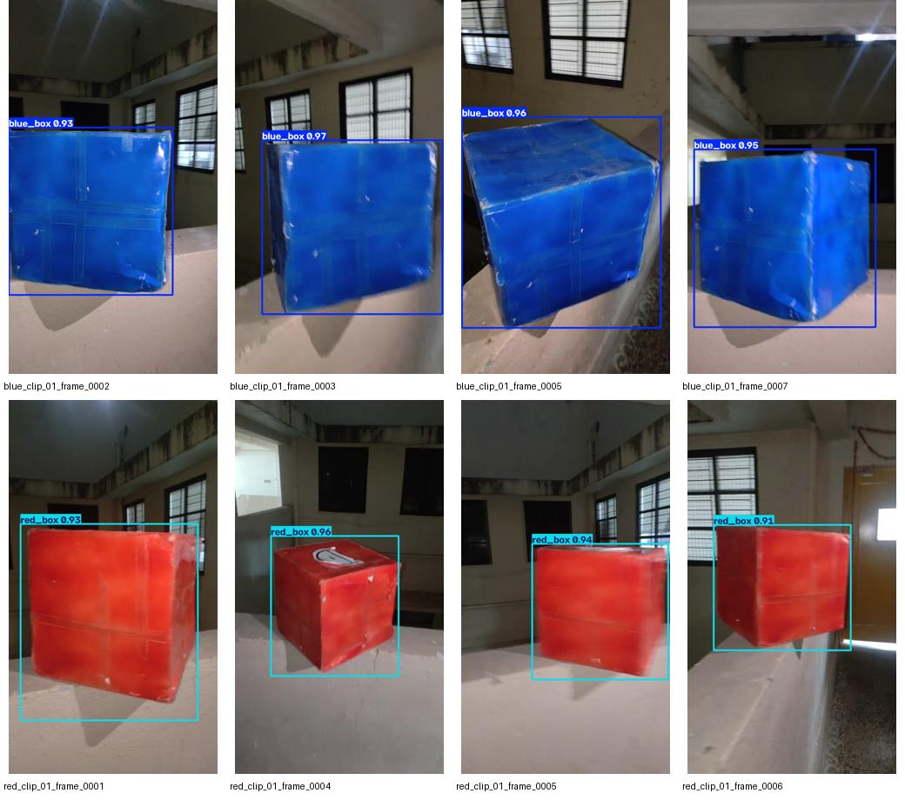

# Blue and red box detector

YOLO11 nano trained on 45 images extracted from phone videos for 80 epochs.
Classes: blue_box and red_box. Eight held-out validation images were correctly
classified; this small validation set does not establish real-world accuracy.
Phone/browser runtime performance has not been tested.

## Downloads

- [Trained model package](trained-box-model.zip): PyTorch weights, ONNX export,
  metrics, input/output specification, and inference instructions.
- [YOLO dataset](yolo11-boxes-dataset.zip): 53 images with matching labels,
  separate images/ and labels/ folders, and train/validation split lists.

Open a ZIP file and use GitHub's Download raw file button to download it.

## Validation preview

