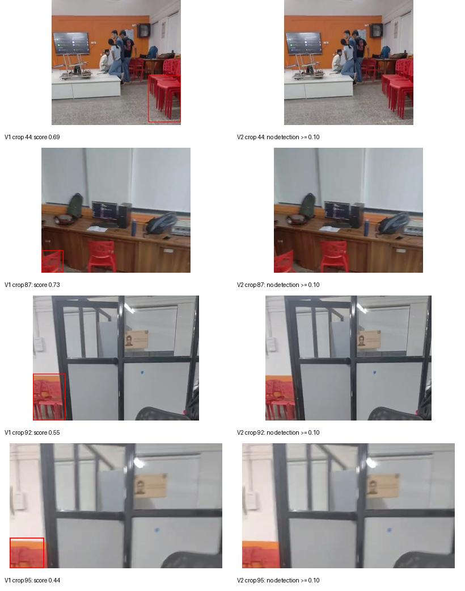

# Blue and red box detector

## Live detection on Android

This repository includes a camera webpage that runs the trained YOLO11 model
locally in Chrome. No Android app or video server is needed. Camera frames and
chosen photos are not uploaded. Open it as a top-level page in Chrome, not an
embedded GitHub preview.

### Enable GitHub Pages once

1. Open repository **Settings → Pages**.
2. Under **Build and deployment**, choose **Deploy from a branch**.
3. Choose **main** and **/(root)**, then **Save**.
4. Wait for GitHub to finish publishing. The page will be at:
   https://speedy107.github.io/First-respository/
5. Open that address in Chrome on your phone. Tap **Start camera** and allow
   camera access. The rear camera is preferred. Tap **Stop** to release it.

The first start downloads about 22 MB for the model and ONNX runtime.
Thereafter Chrome can reuse cached files. All inference runs in the browser.
The confidence slider controls which predictions are shown. **Save frame**
captures a raw, unannotated camera image for reviewing a mistake; it does not
upload it. You can share that image for the next training update. **Choose photo**
lets you test an image without starting the camera. The camera stops when you
switch away from the page; tap Start camera again when you return.

HTTPS is required for phone camera access. A local HTTP server opened by LAN IP
from a phone will not normally have camera permission. Actual iQOO Neo 6 speed
has not been measured; the UI displays inference time. Only blue_box/red_box
are trained; it does not measure millimeters or recognize the sky block.

## Browser implementation

- index.html / styles.css: phone-friendly controls and live detection overlay.
- app.js: camera lifecycle, local ONNX inference, and still-image testing.
- detector.js: RGB letterbox preprocessing and class-aware YOLO NMS.
- models/boxes-yolo11n.onnx: trained FP32 model, fixed 320x320 input.
- vendor/: ONNX Runtime Web 1.20.1 WASM files served from this repository.

The runtime uses one WASM thread so ordinary GitHub Pages hosting works without
cross-origin isolation headers. No CDN dependency or inference API is used.
Browser validation passed in Chromium at a 412-pixel mobile viewport: all eight
held-out images returned their expected class, the camera loop produced at
least five consecutive updates using an uploaded clip as a simulated webcam,
Stop released the camera tracks, and permission/model-download failure messages
worked. Only same-origin GET requests occurred; no image/video uploads occurred.
This validates the browser workflow on the cloud CPU, not speed on the phone.

Runtime assets are vendored from onnxruntime-web@1.20.1 on npm; its MIT license
is included in vendor/ONNX-Runtime-LICENSE.txt. The model was trained using
Ultralytics YOLO11; see https://www.ultralytics.com/license for its license.

## Model v2: fewer background mistakes

The original YOLO11 nano model was trained on 45 box images. V2 was fine-tuned
for 24 epochs using those positives plus 57 reviewed background-only crops with
people, chairs, bags, and room clutter. The eight held-out box images still
produce correct labels. An additional 15 held-out backgrounds produce no boxes.

In a same-input comparison on 108 reviewed training-source backgrounds, V1
produced false positives on four images at confidence 0.35; V2 produced none.
Many of these backgrounds were used to train V2, so this is a regression check,
not an independent test of unfamiliar clothing or bags. The user's specific
red-salwar and blue-bag examples still need to be supplied and tested.

The final epoch-24 checkpoint passed fixed 320x320 and browser checks. The
training runner's automatic best checkpoint did not pass a fixed-shape browser
case and was not deployed. Fixed-square validation mAP50-95 is 83.3% on this
small set; it does not establish real-world accuracy. Browser regression checks
also covered sustained simulated camera frames, the four known mistakes, raw
frame downloads, and camera release. Actual phone speed for V2 remains unmeasured.

See [detailed comparison](background-comparison.json). Classes: blue_box and
red_box. No sky class or physical dimension measurement is included.

## Downloads

- [Trained model package](trained-box-model.zip): PyTorch weights, ONNX export,
  metrics, input/output specification, and inference instructions.
- [YOLO dataset](yolo11-boxes-dataset.zip): 125 images with matching labels (including 72 background-only images),
  separate images/ and labels/ folders, and train/validation split lists.

Open a ZIP file and use GitHub's Download raw file button to download it.

## Validation preview

