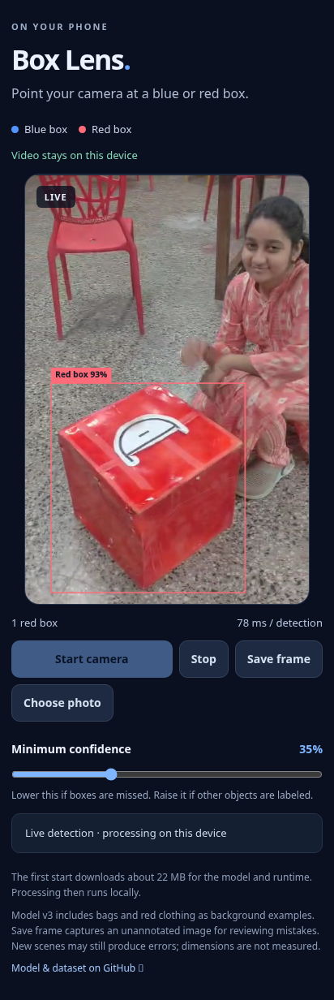

# Blue and red box detector

## Live detection on Android

This repository includes a camera webpage that runs the trained YOLO11 model
locally in Chrome. No Android app or video server is needed. Camera frames and
chosen photos are not uploaded. Open it as a top-level page in Chrome, not an
embedded GitHub preview.

### Enable GitHub Pages once

1. Open repository **Settings → Pages**.
2. Under **Build and deployment**, choose **Deploy from a branch**.
3. Choose **main** and **/(root)**, then **Save**.
4. Wait for GitHub to finish publishing. The page will be at:
   https://speedy107.github.io/First-respository/
5. Open that address in Chrome on your phone. Tap **Start camera** and allow
   camera access. The rear camera is preferred. Tap **Stop** to release it.

The first start downloads about 22 MB for the model and ONNX runtime.
Thereafter Chrome can reuse cached files. All inference runs in the browser.
The confidence slider controls which predictions are shown. **Save frame**
captures a raw, unannotated camera image for reviewing a mistake; it does not
upload it. You can share that image for the next training update. **Choose photo**
lets you test an image without starting the camera. The camera stops when you
switch away from the page; tap Start camera again when you return.

HTTPS is required for phone camera access. A local HTTP server opened by LAN IP
from a phone will not normally have camera permission. Actual iQOO Neo 6 speed
has not been measured; the UI displays inference time. Only blue_box/red_box
are trained; it does not measure millimeters or recognize the sky block.

## Browser implementation

- index.html / styles.css: phone-friendly controls and live detection overlay.
- app.js: camera lifecycle, local ONNX inference, and still-image testing.
- detector.js: RGB letterbox preprocessing and class-aware YOLO NMS.
- models/boxes-yolo11n.onnx: trained FP32 model, fixed 320x320 input.
- vendor/: ONNX Runtime Web 1.20.1 WASM files served from this repository.

The runtime uses one WASM thread so ordinary GitHub Pages hosting works without
cross-origin isolation headers. No CDN dependency or inference API is used.
Browser validation passed in Chromium at a 412-pixel mobile viewport: all eight
held-out images returned their expected class, the camera loop produced at
least five consecutive updates using an uploaded clip as a simulated webcam,
Stop released the camera tracks, and permission/model-download failure messages
worked. Only same-origin GET requests occurred; no image/video uploads occurred.
This validates the browser workflow on the cloud CPU, not speed on the phone.

Runtime assets are vendored from onnxruntime-web@1.20.1 on npm; its MIT license
is included in vendor/ONNX-Runtime-LICENSE.txt. The model was trained using
Ultralytics YOLO11; see https://www.ultralytics.com/license for its license.

## Model v3: blue bag and red-clothing examples

Version 3 adds IMG_20261007_202141.jpg and ten one-second-spaced frames from
VID-20261008-WA0003.mp4. Only the actual blue/red blocks receive labels. The
blue bag and person in red clothing are unlabelled background. V2's detector
predictions were not used as ground-truth labels; every new block rectangle
was drawn and visually checked manually.

Inspect the corrected annotation previews: [photo + frames 1–3](training-labels-v3/manual-labels-1.jpg),
[frames 4–7](training-labels-v3/manual-labels-2.jpg), and
[frames 8–10](training-labels-v3/manual-labels-3.jpg).
[Exact annotation coordinates](training-labels-v3/manual-labels.json) are included.
The rectangles tightly enclose visible block surfaces. An axis-aligned rectangle
around an angled block can still contain background or occluding fingers at a
corner; the person and bag are never labelled as target objects.

Two bag-only and ten red-clothing-only crops were checked to contain no block
pixels and added with empty label files. See the
[background examples](training-labels-v3/new-negative-crops.jpg).
All images derived from the new photo/video remain in training. The original
held-out recordings are unchanged; adjacent frames are not split across sets.

V3 was fine-tuned for 31 epochs from V2 and uses the best epoch-16 checkpoint.
Training now has 125 images: 56 positives and 69 backgrounds. Validation has
23 images: 8 positives and 15 backgrounds. Training-time validation now uses
the same fixed 320x320 input as the browser.

Python regression checks passed on all 46 selected examples. Chromium checks
found one correctly located block in each of the 11 new positive images, with
rectangle IoU at least 0.86 against the manual annotations. All 12 new bag/
clothing crops produced no boxes, and the eight original held-out box images
still passed. The original new video used as a simulated live camera produced
58 updates: one red block per update, no extra detections or JavaScript errors.
See [regression results](regression-results-v3.json) and
[live-video check](live-video-check-v3.json).

These new examples were used for training, so their results are regression
checks, not independent accuracy measurements. Fixed-square validation
mAP50-95 is 86.6% on the small original held-out set. Actual V3 phone speed and
performance on new views remain untested here. Classes remain blue_box and
red_box; no sky class or millimeter measurement is included.

The earlier V1/V2 red-chair comparison remains available in
[background-comparison.json](background-comparison.json) and
[false-positive-comparison.jpg](false-positive-comparison.jpg).

## Downloads

- [Trained model package](trained-box-model.zip): PyTorch weights, ONNX export,
  metrics, input/output specification, and inference instructions.
- [YOLO dataset](yolo11-boxes-dataset.zip): 148 images with matching labels (including 84 background-only images),
  separate images/ and labels/ folders, and train/validation split lists.

Open a ZIP file and use GitHub's Download raw file button to download it.

## Validation preview

